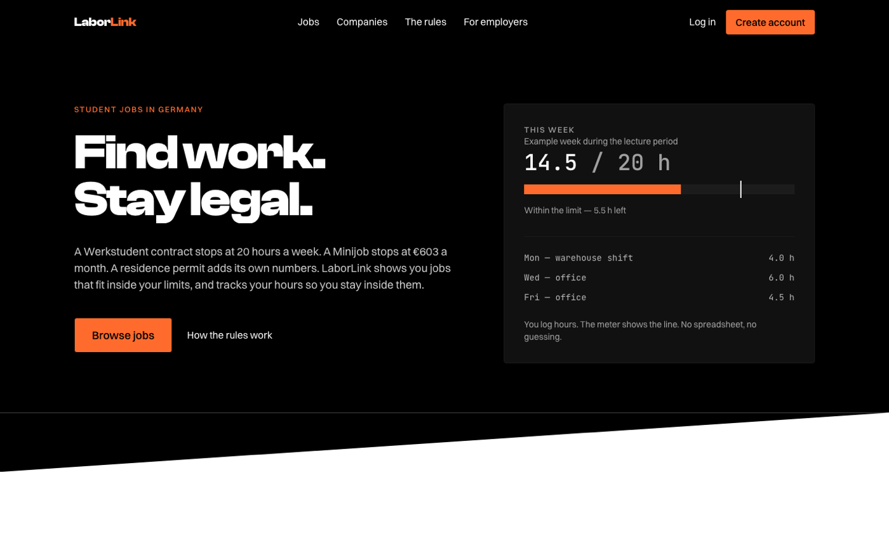
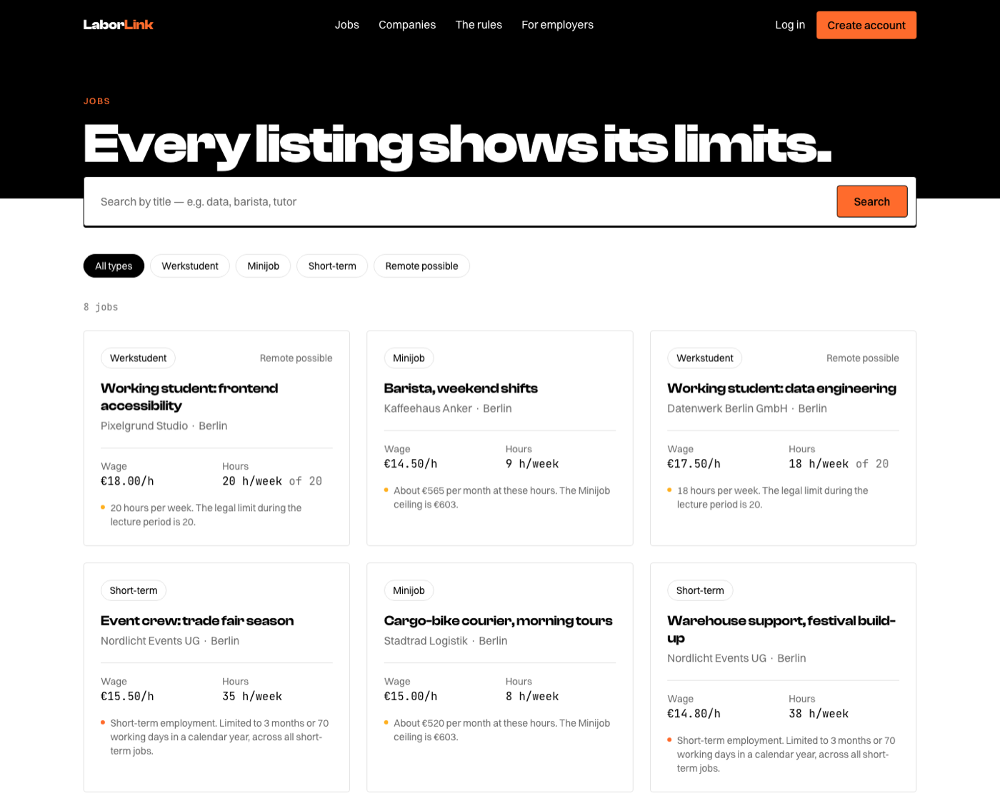
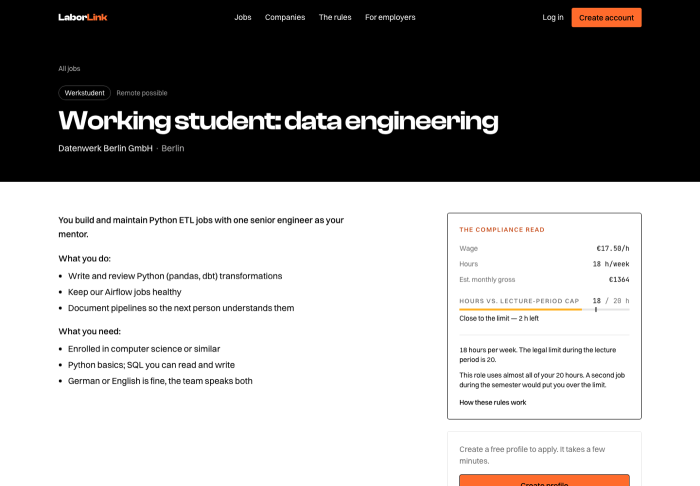
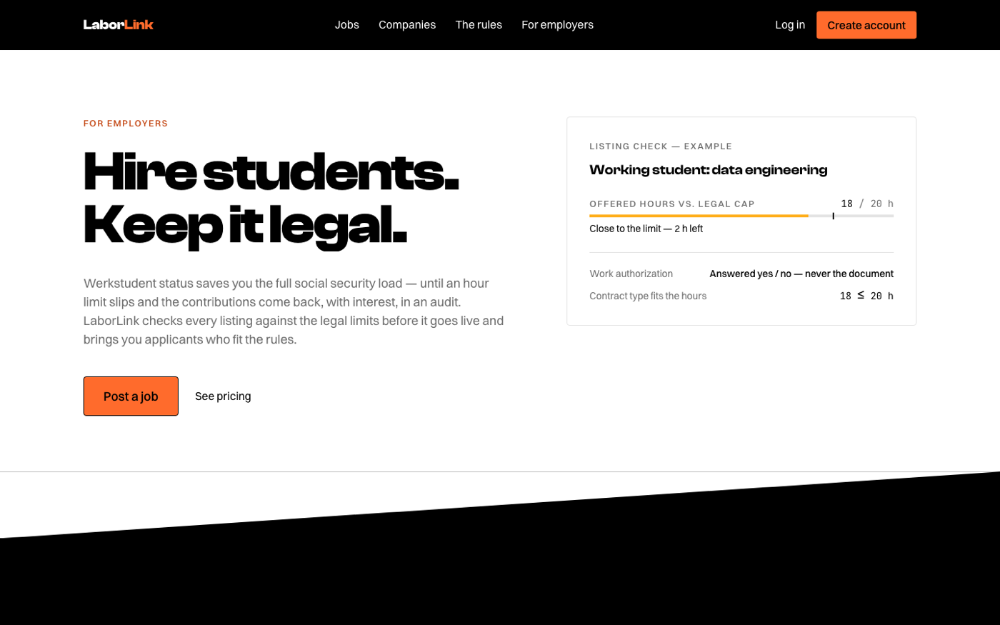
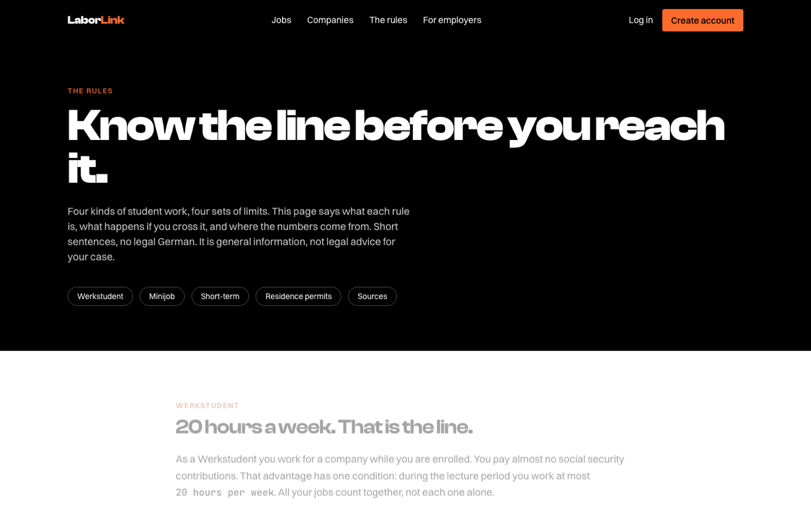

# LaborLink

A two-sided marketplace for the German student labor market, where the compliance
layer is the product.

German student work is governed by limits that are invisible until someone crosses
one: 20 hours a week on a Werkstudent contract, a monthly earnings ceiling on a
Minijob, a separate day allowance on a §16b residence permit. Cross a line and the
consequences land on the student — back-paid social contributions, or a problem with
the permit itself. LaborLink makes those limits visible before they are crossed.

**Live:** https://laborlink-marketplace.vercel.app



---

## What it does

**For students.** Browse roles where every listing states its hours and pay against
the legal limit *before* you apply. Log the hours you work — across every job, including
employers who aren't on the platform — and watch them against the line that actually
applies to you.



Each listing carries a compliance read: what these hours and this wage mean against
the rule for that contract type.



**For employers.** Post roles that are checked against the legal limits before they go
live. A Werkstudent role above the weekly cap, or a Minijob that pays past the monthly
ceiling, is refused at creation rather than discovered in an audit. Review and confirm
the hours your hires log, and record what you paid.



**The rules, in plain language.** Every figure on this page is read from a single
config module, each with a source and a verification date.



---

## How the hard parts work

**Legal thresholds are never hardcoded from memory.** Every limit lives in
`lib/compliance/config.ts` with its statutory basis, a source URL, and the date it was
last verified. Anything user-facing that states a rule reads from there, so correcting a
figure corrects the whole product.

**Employers never see a student's documents.** An application carries a snapshot of
only the fields the student consented to share, written server-side at apply time.
Work authorization crosses that boundary as a derived boolean — never the permit.

**Hours are student-logged and employer-confirmed.** The weekly limit counts every job
a student holds, so an employer-only ledger would under-report it and give false
assurance to the person who bears the penalty. The student keeps the complete picture;
the employing employer confirms or corrects the hours for their own role. A correction
preserves the student's original figure as an audit trail.

**Entitlements are webhook-driven.** Stripe subscription state is written only by a
signature-verified webhook. No success redirect or client response ever grants access.

**No money moves through the platform.** Payment records are bookkeeping: gross pay
derived from confirmed hours, marked paid by the employer. Wage tax and social
contributions remain the employer's payroll duty. Holding or transmitting wages is a
regulated activity and is deliberately out of scope.

## Security

Personal data is the point of this product and its largest liability — residence permit
status, nationality, salary, hours worked.

- Row Level Security is enabled on every table, with policies written per operation.
  Default deny; `auth.uid()` is the only trusted identity inside a policy.
- `scripts/test-rls.mjs` exercises every tenant boundary from the *other* side — as a
  different student, a different employer, and anonymously. 52 assertions, which must
  stay green.
- The `service_role` key is server-only, guarded by `server-only` imports so a client
  import fails the build.
- No personal data in logs, error messages, URLs, or analytics.

## Stack

Next.js 16 (App Router) · React 19 · TypeScript · Tailwind CSS v4 ·
Supabase (Postgres + Auth, Frankfurt) · Stripe · Vercel

## Running locally

Requires Node 20+ and Docker (for the local Supabase stack).

```bash
npm install
npx supabase start      # local Postgres, Auth and Storage; prints local keys
npm run dev             # http://localhost:3000
```

Copy `.env.example` to `.env.local` and fill it with the values `supabase start`
prints. Migrations in `supabase/migrations/` are applied automatically; `supabase
db reset` reapplies them with seed data.

```bash
node scripts/test-rls.mjs   # cross-tenant policy tests — keep green
npm run build               # production build
```

## Project layout

```
app/                 routes — (site) public, dashboard student, employer employer
  auth/confirm/      email confirmation landing
  api/stripe/        signature-verified webhook
components/          UI, including the limit meter
lib/compliance/      legal thresholds, each with source and verified date
lib/                 Supabase clients, entitlements, payment derivation
supabase/migrations/ schema and RLS policies
scripts/test-rls.mjs cross-tenant security tests
proxy.ts             session refresh and route guards (Node.js runtime)
```

## Status

Phase 1 (marketplace) is built and deployed. Phase 2 (compliance tooling) is
partly in: employer-confirmed hours and payment records are live. Phase 3
(integrated payroll) is not started.

Not yet built: document vault uploads, account settings and GDPR erasure, employer
MFA, and rate limiting.

## Notes

Screenshots of the job list and listing detail use local seed data; the production
database starts empty and fills as employers post real roles.

LaborLink explains legal rules in plain language. It is not legal advice.
